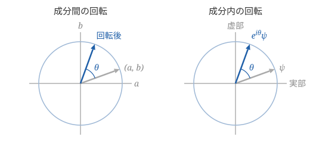
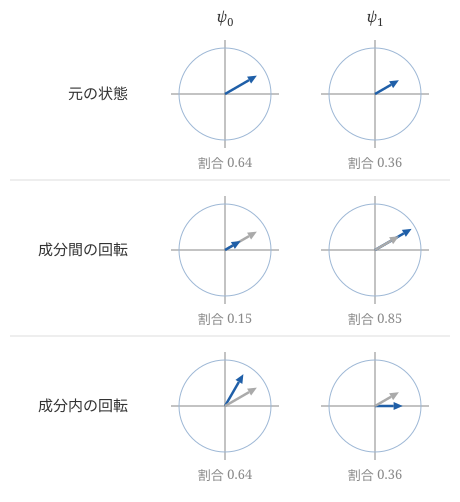
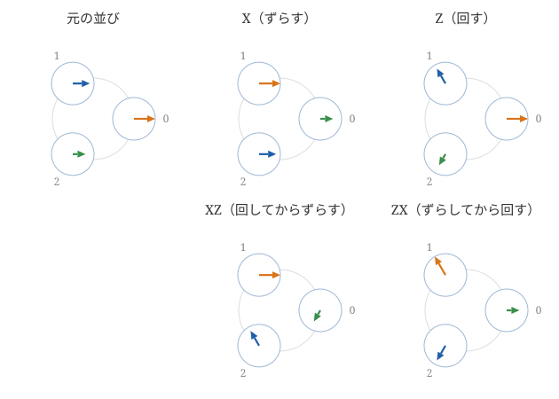
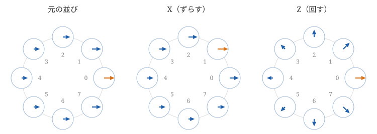
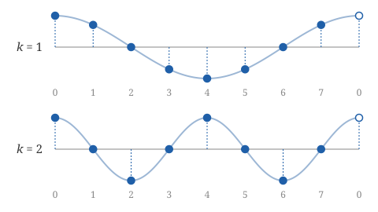
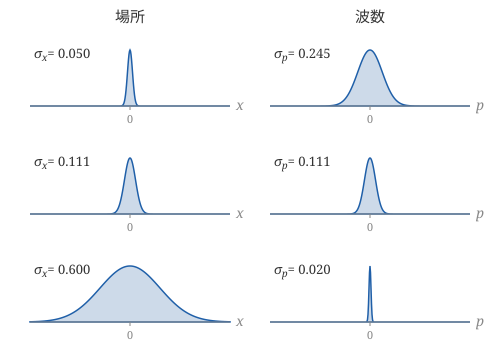
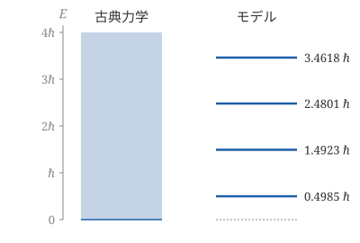

掛ける順序を入れ替えられない文字の多項式を$n$準位系の操作として読み、入れ替えで生じる位相差が小さいときに現れる構造が、量子現象とシュレーディンガー方程式を再現することを紹介します。

# 概要

量子力学の入門では、位置$Q$と運動量$P$が$QP-PQ=i\hbar$という関係（正準交換関係）を満たすことが、出発点として天下りに与えられます。掛ける順序を入れ替えると結果が変わるというだけでも馴染みにくいのに、その差がちょうど虚数単位とプランク定数$\hbar$の積になる理由は説明されません。

本記事では、この関係を、物理を前提としない数学のモデルの中に見つけます。出発点は、$xz$と$zx$を区別する多項式です。入れ替えのたびに符号が反転する（$zx=-xz$）という規則を課すと、クリフォード代数と呼ばれる体系が得られます。この文字は、2個の複素数の組に対する操作として実現できます。複素数の組には、成分の間で割合を移す回転と、1つの成分の中で位相を回す回転の2種類があり、その両方を備えたものが**2準位系**です。成分を3個、$n$個と増やすと、入れ替えで付く符号$-1$は1の$n$乗根$ω$に置き換わり、位相差として現れます。この規則に従う体系が一般化クリフォード代数です。

$n$が大きくなると、位相差$ω$は$1$に近づきます。位相差が極めて小さいけれども消えてはいない場合を特に取り上げ、そのときの$ω$の偏角を$\hbar$と書くことにします。2種類の操作は離散フーリエ変換によって互いに入れ替わる関係にあり、その両方が「ほとんど何もしない」ように見える条件のもとで、入れ替えの規則$zx=ωxz$は$qp-pq=i\hbar$という形（ワイル代数）に移ります。ここまでは数の並びに対する操作の話で、物理は登場しません。

そのうえで、このモデルが表すものを現実の量子現象と見比べます。波長と運動量の関係（物質波）、位置と運動量を同時には絞り込めないこと（不確定性）、とびとびのエネルギーが、モデルの性質として現れます。最後に時間の進み方を加えると、シュレーディンガー方程式が得られます。[[wiki-clif]][[wiki-gca]][[wiki-ccr]][[wiki-schrodinger]]

前提とするのは高校卒業程度の数学です。物理の知識は前提としません。

- 多項式の展開
- 複素数と複素数平面（極形式、1の$n$乗根）
- 微分（積の微分法、1次の近似式）

行列は使いません。全体の見通しを伝えることを目的とし、証明や極限の厳密な扱いには立ち入りません。

# 交換しない文字の多項式

多項式$(ax+bz)^2$を展開します。途中までは分配法則だけで進みます。

$$
(ax+bz)(ax+bz) = a^2xx + ab\,xz + ab\,zx + b^2zz
$$

普通はここで$zx=xz$（交換法則）を使って同類項をまとめ、$a^2x^2+2abxz+b^2z^2$とします。交換法則を使わなければ、$xz$と$zx$は別の項として残ります。本記事では、文字$x,z$どうしの交換法則を仮定しないことにします。係数$a,b$は普通の数で、どの文字とも自由に入れ替えられるものとします。

交換法則の代わりに、次の規則を課してみます。

&&&def 反交換する2文字の規則
$$
x^2 = 1, \quad z^2 = 1, \quad zx = -xz
$$
&&&

入れ替えると符号が反転するという3つ目の規則を**反交換**と呼びます。この規則で先ほどの展開を整理すると、$xz$の項が打ち消し合います。

$$
(ax+bz)^2 = a^2 + ab\,xz - ab\,xz + b^2 = a^2 + b^2
$$

普通の数の範囲では、$a^2+b^2$を1次式の2乗として書くことはできません。反交換する文字を認めると、それができるようになります。

このように、多項式の文字に「2乗すると数になる」「入れ替えると符号が反転する」という規則を課して得られる体系を**クリフォード代数**と呼びます。文字を3個、4個と増やすこともできますが、本記事で使うのは2個の場合だけです。

規則からは、虚数単位に似たものも生じます。積$xz$を1つの文字のように扱って2乗すると、途中で$zx=-xz$を1回使って

$$
(xz)^2 = xzxz = -xxzz = -1
$$

となります。ただし、ここまでは規則を課しただけで、そのような文字が実際にあるのかどうかは確かめていません。次節で、規則を満たすものを具体的に作ります。

# 2準位系

規則を満たすものは、数の組に対する回転の中に見つかります。回転には2種類あるので、順に見ていきます。

## 成分間の回転

実数2個の組$(a,b)$を考え、$a^2+b^2=1$であるとします。$a^2$と$b^2$は合計が$1$なので、2つの成分が全体に占める割合と見ることができます。この組を座標平面上の点とみなして、原点の周りに角$θ$だけ回転します。

$$
(a,\ b) \mapsto (a\cos θ - b\sin θ,\ a\sin θ + b\cos θ)
$$

回転しても原点からの距離は変わらないので、合計$a^2+b^2=1$は保たれ、成分の割合だけが変わります。一方の成分から他方へ割合を移すこの回転を、本記事では**成分間の回転**と呼びます。

## 成分内の回転

次に、複素数1個$ψ$を考えます。以下、絶対値$1$・偏角$θ$の複素数を$e^{iθ}=\cos θ+i\sin θ$と略記します。極形式の積の性質から$e^{iα}e^{iβ}=e^{i(α+β)}$が成り立ち、見た目のとおり指数法則が使えます。

$ψ$に$e^{iθ}$を掛けると、複素数平面上で原点の周りに角$θ$だけ回転します。絶対値$|ψ|$は変わらず、偏角だけが変わります。複素数の偏角を**位相**と呼びます。成分は1個しかないので割合は動かず、1つの成分の中で位相だけが回ります。これを**成分内の回転**と呼びます。

図にすると、どちらも平面上の同じ回転です。違いは、何を回しているかにあります。成分間の回転では、横軸と縦軸が2つの成分$a,b$なので、回すと成分の割合が変わります。成分内の回転では、平面全体が1つの成分$ψ$なので、回しても割合は変わりません。

## 両方の回転を持つ組

複素数2個の組$ψ=(ψ_0,ψ_1)$で、$|ψ_0|^2+|ψ_1|^2=1$であるものを考えます。この組では、両方の回転ができます。

- **成分間の回転**：実数の場合と同じ式で$ψ_0$と$ψ_1$を混ぜる。合計は保たれ、割合$|ψ_0|^2,\ |ψ_1|^2$が変わる
- **成分内の回転**：$ψ_0$と$ψ_1$のそれぞれに、絶対値$1$の複素数を掛ける。割合は変わらず、それぞれの位相が変わる

図は、2つの成分をそれぞれ複素数平面上の矢印として描いたものです。矢印の長さの2乗が割合、向きが位相です。灰色の矢印は元の状態を表します。成分間の回転では矢印の長さが変わって、割合が一方から他方へ移ります。成分内の回転では長さは変わらず、矢印の向きだけが変わります。図の例では、$ψ_0$と$ψ_1$を逆向きに回しています。

成分がそれぞれ位相を持ちながら、成分の割合も変わっていく。これを**2準位系**と呼びます。

## 2つの基本操作

2種類の回転のうち、最も単純なものを1つずつ取り出します。

&&&def 2準位系の基本操作
- **$X$（成分間）**：2つの成分を入れ替える。$X(ψ_0,ψ_1)=(ψ_1,ψ_0)$
- **$Z$（成分内）**：$1$番の成分だけを半回転する（$-1$を掛ける）。$Z(ψ_0,ψ_1)=(ψ_0,-ψ_1)$
&&&

操作の積は、続けて行うことと定めます。$ZX$は、先に$X$、次に$Z$を行う操作です。数$c$は「すべての成分を$c$倍する」操作、特に$1$は「何もしない」操作とみなします。操作の和は、それぞれの結果を成分ごとに足すことと定めます。

$X$も$Z$も、2回行えば元に戻ります。順序を入れ替えるとどうなるかは、実際に行えば分かります。

$$
ZX(ψ_0,ψ_1) = Z(ψ_1,ψ_0) = (ψ_1,-ψ_0), \quad
XZ(ψ_0,ψ_1) = X(ψ_0,-ψ_1) = (-ψ_1,ψ_0)
$$

結果は符号だけ異なります。

&&&fml 基本操作が満たす関係
$$
X^2 = 1, \quad Z^2 = 1, \quad ZX = -XZ
$$
&&&

これは前節の規則そのものです。反交換する文字$x,z$は、2準位系の「成分を入れ替える」操作と「成分の中で半回転する」操作として実現されました。成分間の操作と成分内の操作は、順序を入れ替えると食い違い、その食い違いが符号$-1$です。文字$x,z$についての計算は、そのまま操作$X,Z$についての計算として読めます。

## 回転を基本操作で書く

基本操作の積と和で、一般の角度の回転も書けます。積$XZ$は、上で見たとおり$(ψ_0,ψ_1)$を$(-ψ_1,ψ_0)$に変えます。これは成分間の回転の式で$θ$を直角としたものです。前節で確かめたように$(XZ)^2=-1$なので、$XZ$は虚数単位と同じように振る舞い、角$θ$の回転は$e^{iθ}$と同じ形で書けます。

&&&fml 基本操作で書いた回転
成分間の回転は次のように書ける。
$$
\cos θ + \sin θ\,XZ
$$
成分内の回転のうち、$ψ_0$に$e^{iθ}$、$ψ_1$に$e^{-iθ}$を掛けて位相を逆向きに回すものは、次のように書ける。
$$
\cos θ + i\sin θ\,Z
$$
&&&

1つ目の式を$(ψ_0,ψ_1)$に作用させると$(ψ_0\cos θ-ψ_1\sin θ,\ ψ_1\cos θ+ψ_0\sin θ)$となり、成分間の回転の式に一致します。2つ目の式では、$ψ_0$に$\cos θ+i\sin θ$、$ψ_1$に$\cos θ-i\sin θ$が掛かります。

&&&rem SU(2)と四元数
$XZ$のほかに$iZ$と$iX$も2乗すると$-1$になり、それぞれが回転を生み出します。この3つは、四元数の$i,j,k$と同じ規則に従います。3種類の回転を組み合わせて得られる操作の全体は$SU(2)$と呼ばれ、2準位系の状態の変化はすべてその中にあります。[[7shi-bloch]]
&&&

&&&rem 量子ビット
2準位系は数学の上だけのモデルではなく、そのとおりに振る舞うものが現実にあります。電子のスピン、光の偏光、超伝導回路の2つのエネルギー状態などです。これらを外から制御できるようにしたものを**量子ビット**と呼びます。通常のビットは$0$か$1$のどちらかですが、量子ビットの状態は複素数の組$(ψ_0,ψ_1)$で、読み出す（測定する）と$|ψ_0|^2$の確率で$0$、$|ψ_1|^2$の確率で$1$が得られます。割合と呼んできたものは、この確率にあたります。位相は1個の量子ビットを読み出すだけでは見えませんが、成分間の回転を経ると割合に反映されるので、結果に影響します。

量子コンピューターは、量子ビットを並べ、回転にあたる操作（量子ゲート）を順に施して状態を変えていき、最後に読み出して答えを得る装置です。$X$と$Z$は最も基本的な量子ゲートで、$X$は$0$と$1$を入れ替えるのでビット反転、$Z$は位相反転と呼ばれます。量子ビットを$m$個並べたものは、2準位系$m$個の単なる寄せ集めではなく、全体で$2^m$準位系になります。計算の途中では$2^m$個の複素数が位相を持ったまま一斉に変化し、それらが強め合ったり打ち消し合ったりして、正しい答えの割合が大きくなるように操作を組み立てます。
&&&

# 3準位系と一般化クリフォード代数

成分を3個に増やして、複素数3個の組$ψ=(ψ_0,ψ_1,ψ_2)$で$|ψ_0|^2+|ψ_1|^2+|ψ_2|^2=1$であるものを考えます。これが**3準位系**です。2準位系と同じく、成分間の回転（割合を移す）と成分内の回転（位相を回す）があります。基本操作を1つずつ取り出しましょう。

成分間の操作は、入れ替えの代わりに、3つの成分を順に送る巡回とします。成分内の操作は、半回転の代わりに、3分の1回転を使います。3乗して$1$になる複素数（1の3乗根）のうち、偏角が$\dfrac{2π}3$のものを$ω$とします。

&&&def 3準位系の基本操作
- **$X$（成分間）**：成分を1つずつ隣へ送る。$X(ψ_0,ψ_1,ψ_2)=(ψ_2,ψ_0,ψ_1)$
- **$Z$（成分内）**：$j$番の成分に$ω^j$を掛ける。$Z(ψ_0,ψ_1,ψ_2)=(ψ_0,ωψ_1,ω^2ψ_2)$
&&&

$Z$は、$0$番は回さず、$1$番を3分の1回転、$2$番を3分の2回転します。成分ごとに回す角度が違うことに注意してください。

角度を変えるのには理由があります。すべての成分を同じ角度だけ回す操作は、全体に絶対値$1$の数を掛けることと同じです。これは成分どうしの位相の関係を変えず、どんな操作と入れ替えても結果が変わりません。成分内の回転として意味を持つのは、成分ごとの回す角度の違いの方です。$Z$はその中で最も単純なもので、隣の成分へ進むたびに、回す角度が3分の1回転ずつ増えていきます。$2$番の次の$0$番では、3分の3回転、つまり1周して元に戻ります。2準位系の$Z$も、$0$番は回さず$1$番を半回転するという同じ形をしていました。

どちらの操作も3回行えば元に戻ります。順序を入れ替えた結果を比べます。

$$
ZX(ψ_0,ψ_1,ψ_2) = (ψ_2,\ ωψ_0,\ ω^2ψ_1), \quad
XZ(ψ_0,ψ_1,ψ_2) = (ω^2ψ_2,\ ψ_0,\ ωψ_1)
$$

$ω^3=1$に注意すると、$ZX$の結果は$XZ$の結果のちょうど$ω$倍です。

&&&fml 3準位系の基本操作が満たす関係
$$
X^3 = 1, \quad Z^3 = 1, \quad ZX = ωXZ
$$
&&&

図は、2準位系の図と同じく、成分をそれぞれ複素数平面（小さな円）上の矢印として描いたものです。3つの円は、$0$番から反時計回りに、巡回する順に並べてあります。元の並びでは矢印の向きを右に揃え、どの成分かを追えるように色と長さを変えてあります。$X$は矢印をそのまま隣の円へ送り、$Z$は円を移さずに、$1$番を3分の1回転、$2$番を3分の2回転します。

下段は、2つの操作を続けて行った結果です。$XZ$と$ZX$では、どの円にどの色の矢印があるかは同じです。違いは向きだけで、$XZ$の矢印を3本とも3分の1回転すると$ZX$になります。これが$ZX=ωXZ$です。

2準位系では、入れ替えで付くのは符号$-1$でした。3準位系では、絶対値$1$の複素数$ω$が付きます。つまり、成分間の操作と成分内の操作を入れ替えると、全体に**位相差**が現れます。振り返れば、$-1$も偏角$π$の複素数です。符号の反転は、位相差が半回転であるという特別な場合だったことになります。

## 文字の規則として

2準位系の操作の規則がクリフォード代数でした。同じように、$n$個の成分に対する操作の規則を、文字の規則として取り出します。1の$n$乗根のうち、偏角が$\dfrac{2π}n$のものを改めて$ω$とします。

$$
ω = \cos\frac{2π}n + i\sin\frac{2π}n = e^{2πi/n}
$$

&&&def ねじれて交換する2文字の規則
$$
x^n = 1, \quad z^n = 1, \quad zx = ωxz
$$
&&&

この規則に従う文字の多項式（係数は複素数）の体系を**一般化クリフォード代数**と呼びます。$n=2$の場合が、最初の節のクリフォード代数です。[[wiki-gca]]

クリフォード代数では$(ax+bz)^2=a^2+b^2$が成り立ちました。同じことが一般化クリフォード代数でも起こります。

&&&ex $n=3$での展開
$n=3$として$(ax+bz)^3$を展開する。$a^2b$の係数には、2個の$x$と1個の$z$の並べ方が3通り現れる。規則$zx=ωxz$で$z$を右端に寄せると、$x$を1個追い越すたびに$ω$が付くので

$$
xxz + xzx + zxx = (1+ω+ω^2)\,x^2z = 0
$$

となる。1の3乗根は単位円上に均等に並ぶので、和$1+ω+ω^2$は$0$である。$ab^2$の係数も同様に消えるので、残るのは両端の項だけである。

$$
(ax+bz)^3 = a^3x^3 + b^3z^3 = a^3 + b^3
$$
&&&

一般の$n$でも$(ax+bz)^n=a^n+b^n$が成り立ちます。証明には立ち入りませんが、途中の項がすべて消える仕組みは上の例と同じで、1の$n$乗根の和が$0$になることによります。

&&&rem SU(3)と九元数
3準位系の状態の変化の全体は$SU(3)$と呼ばれます。3準位系に対する操作は、どれも$X^aZ^b$（$a,b$は$0,1,2$）の9個の数倍の和として書けることが知られており、$SU(3)$の操作もその中にあります。つまり3準位系で起こることは、すべて一般化クリフォード代数の中で書けます。この9個を基底とする体系は、四元数の3次版としてシルベスターが1882年に導入した九元数と同じものです。[[7shi-nonion]]
&&&

&&&rem クォークの色
3準位系のとおりに振る舞うものも現実にあります。陽子や中性子は**クォーク**と呼ばれる粒子が3個集まってできており、クォークは**色**と呼ばれる3通りの状態（赤・緑・青と名付けられていますが、目に見える色とは関係ありません）を持ちます。1個のクォークの色の状態は、3つの色に対応する複素数の組$(ψ_0,ψ_1,ψ_2)$で表されます。クォークどうしは**グルーオン**と呼ばれる粒子をやり取りして結び付いており、やり取りのたびにクォークの色が変わります。色の成分間の回転と成分内の回転が、力の働きそのものにあたるわけです。この回転の全体が$SU(3)$で、基本になる回転の種類が8通りあることに対応して、グルーオンも8種類あります。$8$という数は、9個の$X^aZ^b$から、何もしない操作$1$（$a=b=0$の場合）を除いた残りの個数です。

量子ビットとの違いは、色を外から制御したり読み出したりはできないことです。クォークは単独では取り出せず、3つの色が打ち消し合った組み合わせ（陽子や中性子など）としてだけ観測されます。
&&&

# $n$準位系と位相差

一般の$n$では、複素数$n$個の組$ψ=(ψ_0,ψ_1,\dots,ψ_{n-1})$を考えます。これが**$n$準位系**です。時計の文字盤のように、$n$個の成分を円周上に等間隔に並べておくと、基本操作が見やすくなります。$n-1$番の次は$0$番に戻ります。

&&&def $n$準位系の基本操作
- **$X$（ずらす）**：成分を隣へ1つ送る。$j$番には、$j-1$番にあった数が来る
- **$Z$（回す）**：$j$番の成分に$ω^j$を掛ける。番号に比例した角度だけ回し、場所は動かさない
&&&

$Z$が掛ける$ω^j$は、単位円を$n$等分した$j$番目の点そのものです。つまり$Z$は、文字盤の位置に応じた角度だけ、その場の数を回します。回す角度は、隣へ進むたびに1目盛り分（1周の$\dfrac1n$）ずつ増えていき、文字盤を1周するとちょうど1周分になります。成分ごとに好きな角度で回す操作は他にもありますが、角度の増え方が一定であるのは$Z$とその繰り返し（$Z^2,Z^3,\dots$）だけです。

図は$n=8$の例です。2準位系の図では、2つの成分をそれぞれ複素数平面上の矢印として描き、横に並べました。ここでは同じ矢印を8個、文字盤の数字の位置に並べています。小さな円の1つ1つが1つの成分の複素数平面で、矢印の長さの2乗が割合、向きが位相です。大きな円は成分の並ぶ順番を示しているだけで、複素数平面ではありません。

元の並びでは、矢印の向きをすべて右（位相$0$）に揃え、$0$番を最も長くして色を変えてあります。$X$を行うと、矢印は向きも長さもそのままで、隣の小さな円へ移ります。$Z$を行うと、矢印は円を移らず、それぞれの円の中で、$j$番の矢印が1周の$\dfrac j8$だけ回ります。向きを揃えてあったので、回した後の矢印はどれも文字盤の外側を向きます。

この2つの操作が規則を満たすことを確かめます。$X$を$n$回行うと数は円周を1周して元に戻り、$Z$を$n$回行うと掛かるのは$(ω^j)^n=1$なので、$X^n=1,\ Z^n=1$です。残る規則は、$j$番に来る数を追えば分かります。

- **$ZX$**：先にずらすと、$j$番には$ψ_{j-1}$が来る。そこで回すので、$ω^jψ_{j-1}$になる
- **$XZ$**：先に回すと、$j-1$番の数は$ω^{j-1}ψ_{j-1}$になる。それが$j$番にずれて来る

2つの結果は$ω$倍だけ異なります。回す角度が隣どうしでちょうど1目盛り分ずつ違うので、ずらす前に回すか後に回すかで、どの成分にも同じ1目盛り分の違いが出るわけです。

&&&fml $n$準位系の基本操作が満たす関係
$$
X^n = 1, \quad Z^n = 1, \quad ZX = ωXZ
$$
&&&

「場所に応じて回す」と「場所をずらす」は、順序を入れ替えると1目盛り分だけ回し方が食い違います。入れ替えで現れる位相差は$ω$で、その偏角は$\dfrac{2π}n$です。準位が増えるほど$ω$は$1$に近づき、位相差は小さくなります。$n$準位系の性質は、この$ω$がすべて決めています。

# 波の並びと離散フーリエ変換

$X$は成分をずらし、$Z$は成分を回します。2つの操作はまったく性格が違うように見えますが、並びの表し方を変えると役割が入れ替わります。位相差が小さいときの様子を調べる準備として、この関係を見ておきます。

## 1点の並びと波の並び

$Z$の働きが最も単純に見えるのは、1か所だけに数がある並びです。$j$番だけが$1$で他が$0$の並びを$u_j$と書くと、$Z$は$u_j$を$ω^j$倍するだけで、形を変えません。$X$は$u_j$を隣の$u_{j+1}$に変えます。

では逆に、$X$が形を変えない並びはあるでしょうか。ずらしても形が変わらないのは、どこも同じ調子で続いている並びです。$j$番の成分が$ω^{jk}$である並びを$w_k$と書きます（$k=0,1,\dots,n-1$）。

$$
w_k = (1,\ ω^k,\ ω^{2k},\ \dots,\ ω^{(n-1)k})
$$

隣へ進むたびに位相が一定の角度$\dfrac{2πk}n$ずつ回り、文字盤を1周する間に位相がちょうど$k$周します。

この並びの実部だけを取り出すと、$j$番の成分は$\cos\dfrac{2πkj}n$です。たとえば$n=8$では、$k=1$と$k=2$の実部は次のようになります。

$$
\begin{aligned}
k=1 &\quad 1,\ 0.71,\ 0,\ -0.71,\ -1,\ -0.71,\ 0,\ 0.71 \\
k=2 &\quad 1,\ 0,\ -1,\ 0,\ 1,\ 0,\ -1,\ 0
\end{aligned}
$$

番号を横軸に取ってグラフにすると、次のようになります。右端の白丸は、1周して戻ってきた$0$番です。

点は、山と谷が交互に並ぶ余弦曲線、つまり波の形に沿って並びます。虚部も、4分の1周期だけずれた同じ形（正弦曲線）になります。文字盤を1周する間に、$k=1$では山が1個、$k=2$では山が2個現れます。そこで$w_k$を**波**、1周の間の山の個数にあたる$k$を**波数**と呼ぶことにします。波数が大きいほど、細かく波打つ並びです。

波は、ずらしても形が変わりません。山と谷がどこまでも同じ調子で繰り返しているので、ずらすことは、波の始まりの位置（位相）を変えることと同じだからです。実際、波をずらすと、$j$番には$ω^{(j-1)k}=ω^{-k}ω^{jk}$が来るので、全体が$ω^{-k}$倍されるだけです。一方、波に$Z$を行うと、$j$番の成分は$ω^j\cdot ω^{jk}=ω^{j(k+1)}$となり、波数が1つ大きい波に変わります。

&&&fml 2種類の並びに対する基本操作
$$
\begin{array}{c|cc}
& Z\ (\text{回す}) & X\ (\text{ずらす}) \\
\hline
\text{1点の並び } u_j & ω^ju_j & u_{j+1} \\
\text{波の並び } w_k & w_{k+1} & ω^{-k}w_k
\end{array}
$$
&&&

1点の並びに対しては$Z$が位相を掛けて$X$が番号を進め、波の並びに対しては$X$が位相を掛けて$Z$が番号を進めます。2つの操作は、対等な関係にあります。

## 並びを波に分ける

どんな並びも、波の重ね合わせとして表せます。それぞれの波がどれだけ含まれているかを表す数を$φ_k$とすると、次の式で行き来できます。

&&&def 離散フーリエ変換
$$
φ_k = \frac1{\sqrt n}\sum_{j=0}^{n-1}ω^{-jk}ψ_j, \quad
ψ_j = \frac1{\sqrt n}\sum_{k=0}^{n-1}ω^{jk}φ_k
$$
&&&

並び$ψ=(ψ_0,\dots,ψ_{n-1})$から、波の量の並び$φ=(φ_0,\dots,φ_{n-1})$を求める操作を**離散フーリエ変換**と呼びます。2つの式が互いに逆の関係になっていることは、1の$n$乗根の和が$0$になることから確かめられますが、ここでは立ち入りません。$\dfrac1{\sqrt n}$は、合計$|φ_0|^2+\cdots+|φ_{n-1}|^2$が元の合計$|ψ_0|^2+\cdots+|ψ_{n-1}|^2$と等しくなるように付けた係数です。つまり$|φ_k|^2$は、波数$k$の波が全体に占める割合と読めます。

&&&ex $n=2$：和と差
$ω=-1$なので、波は$w_0=(1,1)$と$w_1=(1,-1)$の2つである。離散フーリエ変換は、和と差を取る操作になる。

$$
φ_0 = \frac{ψ_0+ψ_1}{\sqrt2}, \quad φ_1 = \frac{ψ_0-ψ_1}{\sqrt2}
$$

$ψ_0$と$ψ_1$を入れ替えると、和$φ_0$は変わらず、差$φ_1$は符号が反転する。逆に$ψ_1$の符号を反転すると、和と差が入れ替わる。つまり、$ψ$に対する入れ替え$X$は、$φ$に対しては符号の反転として働き、$ψ$に対する符号の反転$Z$は、$φ$に対しては入れ替えとして働く。
&&&

&&&ex $n=4$：1点の並びと波
$ω=i$なので、波は次の4つである。

$$
\begin{aligned}
w_0 &= (1,\ 1,\ 1,\ 1), & w_1 &= (1,\ i,\ -1,\ -i), \\
w_2 &= (1,\ -1,\ 1,\ -1), & w_3 &= (1,\ -i,\ -1,\ i)
\end{aligned}
$$

波そのもの、たとえば$ψ=\dfrac12w_1$を変換すると$φ=(0,1,0,0)$となり、波の量は1か所に集中する。逆に、1点の並び$ψ=(1,0,0,0)$を変換すると

$$
φ = \left(\frac12,\ \frac12,\ \frac12,\ \frac12\right)
$$

となる。1か所に集中した並びは、すべての波を均等に含んでいる。
&&&

2つ目の例は、後で重要になります。場所について集中した並びは、波数については広がっています。逆に、波数について集中した並び（波そのもの）は、場所については文字盤全体に広がっています。

## 役割の入れ替わり

$n=2$の例で見た役割の入れ替わりは、一般の$n$でも起こります。前項の表のとおり、$Z$は波数を1つ進め、$X$は波数$k$の波を$ω^{-k}$倍するからです。

&&&fml 波の量に対する基本操作
並び$ψ$の代わりに波の量の並び$φ$を見ると、基本操作は次のように働く。

- **$Z$**：$φ$の成分を隣へ1つ送る（ずらす）
- **$X$**：$φ$の$k$番の成分に$ω^{-k}$を掛ける（逆向きに回す）
&&&

離散フーリエ変換を通すと、「回す」と「ずらす」が入れ替わります。成分内の操作と成分間の操作という区別は、並びを場所で表すか波数で表すかという見方の違いでした。一般化クリフォード代数の2つの文字$x,z$が対等であることの、具体的な現れです。

&&&rem 準位が多いとき
$n$が大きいと、並びは文字盤の上の関数を細かく読み取ったものに見えてきます。そのとき波$w_k$は、$\cos$と$\sin$でできた本物の波であり、離散フーリエ変換は、関数を波の重ね合わせに分解するフーリエ級数やフーリエ変換と呼ばれる操作に近づきます。
&&&

# 位相差が小さいとき

ここまでは、準位の数$n$がいくつであっても成り立つ話でした。ここからは、$n$が非常に大きく、位相差$ω$が極めて小さい（$1$に極めて近い）という特別な場合を調べます。このとき$ZX=ωXZ$は$ZX=XZ$に近く、2つの操作はほとんど交換します。しかし$ω$は$1$そのものではないので、食い違いは残っています。その食い違いを、扱いやすい形で取り出すのが本節の目的です。

この特別な場合に限って、$ω$の偏角に専用の記号を用意します。

&&&def 極めて小さい位相差の角度
位相差$ω$が極めて小さいとき、その偏角を$\hbar$と書く。
$$
ω = e^{i\hbar}, \quad \hbar = \frac{2π}n
$$
&&&

$\hbar$は「エイチバー」と読みます。この記号を使う理由は後の節で述べますが、ここでは小さな角度に付けた名前にすぎません。小さくても$0$ではない、決まった大きさの角度です。$ω$が$-1$や1の3乗根であるような、準位の少ない場合には使いません。

## 文字盤の上の関数

$j$番の成分の文字盤上の位置を、角度$x_j=\hbar j$で表します。並び$ψ$を、なめらかな関数$ψ(x)$の値を各点で読み取ったもの$ψ_j=ψ(x_j)$とみなします。隣り合う点の間隔は$\hbar$です。

ここで番号の振り方を少し変えます。$0$番を原点とし、一方の向きに$1,2,\dots$番、逆向きに$-1,-2,\dots$番と、原点の両側に半周ずつ振ることにします。$ω^n=1$より$ω^{-j}=ω^{n-j}$なので、$-j$番と呼んでも$n-j$番と呼んでも$Z$の掛ける数は同じで、操作は何も変わりません。こうすると角度$x$は$-π$から$π$までの値を取ります。波数$k$も同じ理由で、$0$を挟んで正負に振り直します。

2つの操作を関数の言葉に直します。

- **$X$**：$x_j$での値を$x_j-\hbar$での値に取り替えるので、関数$ψ(x)$を$ψ(x-\hbar)$に変える。グラフを$\hbar$だけ平行移動する操作である
- **$Z$**：$ω^j=e^{i\hbar j}=e^{ix_j}$を掛けるので、関数$ψ(x)$を$e^{ix}ψ(x)$に変える。値を、その場所の角度$x$だけ回す操作である

波$w_k$の$j$番の成分は$ω^{jk}=e^{ikx_j}$なので、波は関数$e^{ikx}=\cos kx+i\sin kx$にあたります。

## ほとんど何もしない条件

2つの操作が、どちらも「ほとんど何もしない」ように見える並びを考えます。そのための条件は、操作ごとに1つずつあります。

- **なめらかであること**：隣どうしの値がほとんど変わらなければ、ずらしてもほとんど変わらない。このとき微分の近似式$ψ(x-\hbar)\fallingdotseq ψ(x)-\hbar ψ'(x)$が使える
- **原点の近くに集中していること**：$x$が小さいところにしか値がなければ、回してもほとんど変わらない。$θ$が小さいとき$\cos θ\fallingdotseq1,\ \sin θ\fallingdotseq θ$より$e^{iθ}\fallingdotseq1+iθ$なので、$e^{ix}ψ(x)\fallingdotseq ψ(x)+ixψ(x)$となる

1つ目の条件は、波の言葉で言えば、波数の小さいゆるやかな波だけでできていること、すなわち波数について$0$の近くに集中していることです。2つの条件は、離散フーリエ変換で入れ替わる関係にあります。

前節の例で見たように、場所について集中すると、波数については広がります。したがって2つの条件は互いに反対を向いていて、両方を満たすには、どちらもほどほどに集中させるしかありません。それができるのは、文字盤の目盛りが十分に細かいとき、つまり$\hbar$が小さいときです。$n$が大きいことは、ここで必要になります。

近似式に現れた操作に、名前を付けます。

&&&def 掛け算と微分の操作
- **$Q$**：関数に$x$を掛ける。$ψ(x)$を$xψ(x)$に変える
- **$P$**：関数を微分して$-i\hbar$を掛ける。$ψ(x)$を$-i\hbar ψ'(x)$に変える
&&&

$P$に$-i\hbar$を含めたのは、2つの近似式を同じ形に揃えるためです。

&&&fml 条件のもとでの基本操作
$$
Z \fallingdotseq 1 + iQ, \quad X \fallingdotseq 1 - iP
$$
&&&

## 食い違いを取り出す

文字の計算に戻ります。一般化クリフォード代数の文字$z,x$が、小さな文字$q,p$を使って$z=1+iq+\cdots,\ x=1-ip+\cdots$と書けているとします。これを規則$zx=ωxz$に代入して、2次の項まで比べます。

$$
\begin{aligned}
zx &= (1+iq)(1-ip)+\cdots = 1 + iq - ip + qp + \cdots \\
xz &= (1-ip)(1+iq)+\cdots = 1 - ip + iq + pq + \cdots
\end{aligned}
$$

$q$と$p$の順序を入れ替えないように展開していることに注意してください。省略した「$\cdots$」には、3次以上の項のほかに、$z$だけ、$x$だけの近似を2次まで進めたときに現れる$q^2$や$p^2$の項も含まれます。ただしそれらは$zx$と$xz$に同じ形で現れるので、引き算で消えます。$ω=e^{i\hbar}\fallingdotseq1+i\hbar$より、$ωxz$は$xz$に$i\hbar$を加えたものと（この精度で）等しいので、$zx-ωxz=0$は

$$
qp - pq - i\hbar + \cdots = 0
$$

となります。$\hbar$が$q$と$p$の積と同じ程度に小さいとき、残りの項は無視できます。

&&&fml 位相差が小さいときの規則
$$
qp - pq = i\hbar
$$
&&&

入れ替えると$ω$倍になるという掛け算の形の規則が、入れ替えると$i\hbar$だけずれるという引き算の形の規則に変わりました。右辺は$q$にも$p$にもよらない、ただの数です。

&&&def ワイル代数
規則$qp-pq=i\hbar$に従う2文字$q,p$の多項式（係数は複素数）の体系を**ワイル代数**と呼ぶ。[[wiki-weyl-alg]]
&&&

一般化クリフォード代数には$x^n=1,\ z^n=1$という規則があり、文字盤を1周すると元に戻りました。ワイル代数にはそれにあたる規則がありません。原点の近くだけを見ているので、文字盤が1周して閉じていることが見えなくなったためです。

操作$Q,P$がこの規則を満たすことは、関数に直接作用させて確かめられます。$PQ$は「$x$を掛けてから微分して$-i\hbar$倍する」、$QP$は「微分して$-i\hbar$倍してから$x$を掛ける」です。積の微分法より

$$
QPψ - PQψ = -i\hbar xψ'(x) + i\hbar(xψ(x))' = i\hbar ψ(x)
$$

となり、たしかに差は$i\hbar$倍する操作です。

&&&fml 掛け算と微分の交換関係
$$
QP - PQ = i\hbar
$$
&&&

$x$を掛けることと微分することの食い違いは、積の微分法そのものです。2準位系の反交換から出発して、位相差を細かくしていった先にあったのは、高校で学ぶ微分の公式だったことになります。[[wiki-ccr]]

&&&rem 近似の範囲
$ZX=ωXZ$は、どんな並びに対しても厳密に成り立ちます。$Z\fallingdotseq1+iQ,\ X\fallingdotseq1-iP$という読み替えの方は、場所についても波数についても原点の近くに集中した並びに限って成り立つ近似です。その理由と、$n$を限りなく大きくした極限の厳密な意味には、本記事では立ち入りません。
&&&

## 場所と波数の対称性

$Q$は、1点の並びに対して、その場所の角度$x$を掛ける操作でした。$P$についても同じことが言えます。波$e^{ikx}$を微分すると$ike^{ikx}$になるので

$$
Pe^{ikx} = -i\hbar\cdot ike^{ikx} = \hbar k\,e^{ikx}
$$

です。$P$は、波数$k$の波を$\hbar k$倍します。

&&&fml 波数に対応する値
$$
p = \hbar k
$$
&&&

波数$k$は$-\dfrac n2$から$\dfrac n2$までの整数だったので、$p=\hbar k$は$-π$から$π$までを間隔$\hbar$で動きます。これは場所の角度$x=\hbar j$とまったく同じ範囲、同じ間隔です。$n$準位系は、場所についても波数についても、同じ文字盤を持っています。$Z$は$p$を$\hbar$だけ進め、$X$は$x$を$\hbar$だけ進めます。

&&&rem 準位の数と面積
$x$と$p$を縦横の軸に取ると、どちらも範囲は$2π$なので、全体の面積は$(2π)^2$です。これを準位の数$n$で割ると、$\dfrac{(2π)^2}n=2π\hbar$になります。$n$準位系は、面積$2π\hbar$の区画を$n$個並べたものと読めます。
&&&

# 量子現象との一致

ここまでは、数の並びとそれに対する操作の話で、物理は登場していません。ここからは、このモデルが表すものを、現実の世界で知られている現象と見比べます。

量子力学では、電子のような粒子の状態を、複素数の並び（極限では関数）$ψ$で表します。$|ψ_j|^2$は、粒子が$j$番の場所に見出される確率です。割合の合計が$1$であることは、確率の合計が$1$であることにあたります。$x$は粒子の**位置**、$p$は**運動量**（質量と速度の積）を表し、極めて小さい位相差$ω$の偏角にあたる定数$\hbar$は**プランク定数**と呼ばれます。現実の世界は、位相差が極めて小さい場合のモデルに対応しているわけです。前節の$QP-PQ=i\hbar$は、量子力学で**正準交換関係**と呼ばれる式です。

&&&rem 単位について
モデルの中では、$x$も$p$も角度で、$\hbar=\dfrac{2π}n$でした。現実の位置と運動量には単位があるので、文字盤の1目盛りを位置の間隔$ε$、運動量の間隔$η$と読み替えます。このとき位相差の角度は$\dfrac{εη}\hbar$と表され、プランク定数は$\hbar\fallingdotseq1.05\times10^{-34}\ \mathrm{J\cdot s}$という値を持ちます。位置と運動量の積の単位で測った、非常に小さな量です。
&&&

## 物質波

モデルでは、$p$は波数$k$に$\hbar$を掛けたものでした。波数$k$の波$e^{ikx}$は、$x$が$\dfrac{2π}k$進むごとに同じ値に戻るので、波長は$λ=\dfrac{2π}k$です。したがって

$$
p = \hbar k = \frac{2π\hbar}λ
$$

となります。$2π\hbar$を$h$と書けば、$p=\dfrac hλ$です。

現実の電子は、細い隙間を通すと干渉縞を作るなど、波としての性質を示します。その波長$λ$と運動量$p$の間に$p=\dfrac hλ$という関係があることが実験で確かめられており、**物質波**の関係式と呼ばれています。モデルでは、この関係は仮定ではなく、「運動量とは波数のことである」という構造として最初から含まれています。

## 不確定性

場所について集中した並びは、波数については広がるのでした。これを位置と運動量の言葉で言えば、位置が絞り込まれた状態では運動量がばらつき、運動量が絞り込まれた状態では位置がばらつく、ということです。

ばらつきの大きさを標準偏差で測り、位置について$σ_x$、運動量について$σ_p$とします。両者の積には下限があることが、$QP-PQ=i\hbar$から導かれます。

&&&fml 不確定性関係
$$
σ_xσ_p \geqq \frac\hbar2
$$
&&&

導出には立ち入りませんが、数値で確かめることはできます。

&&&ex ばらつきの積
$n=256$（$\hbar\fallingdotseq0.0245$）として、原点を中心とする釣鐘形（正規分布の形）の並びを作り、離散フーリエ変換して波数のばらつきを測る。

$$
\begin{array}{c|c|c}
σ_x & σ_p & σ_xσ_p \\
\hline
0.050 & 0.245 & 0.500\,\hbar \\
0.111 & 0.111 & 0.500\,\hbar \\
0.600 & 0.020 & 0.500\,\hbar
\end{array}
$$

位置のばらつきを小さくすると運動量のばらつきが大きくなり、積は$\dfrac\hbar2$のまま変わらない。釣鐘形は、積がちょうど下限になる形である。
&&&

図は、表の3つの場合について、場所についての割合$|ψ_j|^2$と、波数についての割合$|φ_k|^2$を、高さを揃えて描いたものです。左が細くなるほど、右は太くなります。

これは量子力学で**不確定性原理**と呼ばれる性質で、現実の粒子で確かめられています。モデルの中では、謎めいた原理ではなく、1点の並びと波の並びが離散フーリエ変換で入れ替わるという事実の言い換えです。

&&&rem 日常の世界では
$\hbar$を無視できるとき、つまり$ω$を$1$とみなせるときは、規則は$zx=xz$となって、文字は普通の数と同じように交換します。日常の大きさの物体では、位置と運動量の積に比べて$\hbar$が桁違いに小さいので、食い違いもばらつきの下限も見えません。位置と運動量を普通の数として扱う従来の力学（古典力学）は、この場合にあたります。
&&&

# シュレーディンガー方程式

ここまでに登場したのは、ある瞬間の並び$ψ$と、それに対する操作だけでした。最後に、$ψ$が時刻$t$とともに変化していく法則を考えます。

## 時間を進める操作

平行移動$X$は、関数を空間の方向に$\hbar$だけずらす操作で、$1-iP$と近似できました。ずらす幅が$\hbar$ではなく小さな$s$であれば、$ψ(x-s)\fallingdotseq ψ(x)-sψ'(x)$より、$1-\dfrac{is}\hbar P$となります。これにならって、関数を時間の方向に進める操作を考えます。短い時間$δ$だけ進める操作も「ほとんど何もしない」操作のはずなので、ある操作$H$を使って同じ形に書けると仮定します。

$$
\begin{array}{l|l}
\text{空間方向に }s\text{ だけずらす} & 1 - \dfrac{is}\hbar P \\
\text{時間方向に }δ\text{ だけ進める} & 1 - \dfrac{iδ}\hbar H
\end{array}
$$

時刻$t$の関数を$ψ(t)$と書くと、この仮定は$ψ(t+δ)\fallingdotseq ψ(t)-\dfrac{iδ}\hbar Hψ(t)$ということです。移項して$δ$で割り、$δ\to0$とすれば左辺は時刻による微分になり、時間変化の法則が得られます。

&&&fml 時間変化の法則
$$
i\hbar\frac{dψ}{dt} = Hψ
$$
&&&

時間変化を生み出す操作$H$を**ハミルトニアン**と呼びます。$P$が空間方向のずれを生み出すのと同じ意味で、$H$は時間方向の進みを生み出します。$i$を付けた形にしているのは、成分間の回転や成分内の回転と同じく、割合の合計を変えない操作にするためです。この合計は確率の合計なので、変わっては困ります。この点の詳細には立ち入りません。

## 文字を置き換える

残る問題は、$H$として何を選ぶかです。ここで古典力学を手がかりにします。古典力学では、質量$m$の粒子が位置$x$にあって運動量$p$を持つとき、そのエネルギーは次の式で表されます。

$$
E = \frac{p^2}{2m} + V(x)
$$

第1項は運動によるエネルギー、第2項は場所によって決まるエネルギーで、$V(x)$は粒子が受ける力の種類に応じて決まる関数です。これは文字$x,p$の式で、古典力学では$x$も$p$も普通の数なので、交換法則が成り立ちます。この式の文字を、$QP-PQ=i\hbar$を満たす操作に置き換えたものを、ハミルトニアンに選びます。

$$
x \to Q, \quad p \to P, \quad H = \frac{P^2}{2m} + V(Q)
$$

交換する文字の式を、交換しない文字の式に置き換えるこの手続きを**正準量子化**と呼びます。$V(Q)$は、関数に$V(x)$を掛ける操作を表します。

$P^2$は「微分して$-i\hbar$倍する」を2回行う操作なので、関数を2回微分して$-\hbar^2$倍します。$ψ$は位置$x$と時刻$t$の両方に依存するので、どちらの変数で微分するかを区別して$\dfrac{\partial}{\partial t},\ \dfrac{\partial}{\partial x}$と書くと（他方の変数は定数とみなして微分します）、時間変化の法則は次の方程式になります。

&&&fml シュレーディンガー方程式
$$
i\hbar\frac{\partial ψ}{\partial t} = -\frac{\hbar^2}{2m}\frac{\partial^2ψ}{\partial x^2} + V(x)ψ
$$
&&&

これが**シュレーディンガー方程式**で、原子や分子の中の電子の振る舞いを定める、量子力学の基本方程式です。[[wiki-schrodinger]]

エネルギーの式の文字を置き換えるだけで正しい力学が得られるというのは、不思議に思えるかもしれません。実際には、この方程式に従う$ψ$について位置と運動量の平均値を計算すると、古典力学の運動の法則と同じ形の関係が、$QP-PQ=i\hbar$から導かれます。置き換えの正当性を支えているのはその事実ですが、本記事では扱いません。

## $n$準位系に戻る

シュレーディンガー方程式は、近似を行う前の$n$準位系の中に、すでに原型があります。それを確かめるために、$H$を$X$と$Z$で書き直します。

運動によるエネルギーの項は、成分間の操作$X$から作れます。$X$の逆向きの操作（1つ戻す）を$X^{-1}$と書きます。規則$X^n=1$より$X^{-1}=X^{n-1}$なので、これも$X$だけで書ける操作です。近似を2次の項まで進めると

$$
X \fallingdotseq 1 - iP - \frac{P^2}2, \quad X^{-1} \fallingdotseq 1 + iP - \frac{P^2}2
$$

となり、足し合わせると1次の項が打ち消し合って$P^2$だけが取り出せます。

$$
2 - X - X^{-1} \fallingdotseq P^2
$$

左辺を数の並びに作用させると、$j$番では$-(ψ_{j+1}-2ψ_j+ψ_{j-1})$になります。括弧の中は$(ψ_{j+1}-ψ_j)-(ψ_j-ψ_{j-1})$、つまり隣との差の、そのまた差です。差を間隔$\hbar$で割ると傾きになり、傾きの差をもう一度$\hbar$で割ると傾きの変化率、すなわち2階微分になります。差の差は2階微分の$\hbar^2$倍で、$P^2$が2回微分の$-\hbar^2$倍であることと合っています。

場所によって決まるエネルギーの項$V(Q)$は、$j$番の成分に$V(x_j)$を掛ける操作です。場所を動かさずに成分ごとに数を掛ける操作は、どれも$1,Z,Z^2,\dots,Z^{n-1}$の数倍の和として書けることが知られています（証明には立ち入りません）。こちらは成分内の操作$Z$から作れるわけです。

したがって、$n$準位系では、時間変化の法則は次の形になります。

&&&fml $n$準位系でのシュレーディンガー方程式
$$
i\hbar\frac{dψ_j}{dt} = -\frac{ψ_{j+1} - 2ψ_j + ψ_{j-1}}{2m} + V(x_j)ψ_j
$$
&&&

右辺は$X$と$Z$の多項式を$ψ$に作用させたもので、一般化クリフォード代数の中だけで書けています。運動によるエネルギーは成分間の操作から、場所によるエネルギーは成分内の操作から作られます。前者は隣の成分との間で割合を移し、後者はそれぞれの成分の位相を回します。この2種類の操作が交換しないことが、$ψ$に単純でない時間変化をもたらします。2準位系では2つの成分の間で割合が行き来するだけの力学ですが、同じ形の方程式で準位を増やし、原点の近くだけを見たものが、前項のシュレーディンガー方程式です。

## とびとびのエネルギー

最後に、$X$と$Z$を対等に使った例を1つ見ます。運動による項を$X$から作ったのと同じ形で、場所による項を$Z$から作ります。

$$
H = \frac{2 - X - X^{-1}}2 + \frac{2 - Z - Z^{-1}}2
$$

$2-Z-Z^{-1}\fallingdotseq Q^2$なので、これは$H\fallingdotseq\dfrac{P^2}2+\dfrac{Q^2}2$であり、古典力学ではばねにつながれた粒子の振動を表すエネルギーの式にあたります。

$H$を行っても全体が数$E$倍されるだけの並び（$Hψ=Eψ$）を考えます。このような並びは、時間変化の法則のもとで位相が回るだけで割合が変わらず、$E$はその状態のエネルギーにあたります。$E$としてどんな値が許されるかを数値計算で求めると、次のようになります。

&&&ex エネルギーの値
$n=256$のとき、$E$を小さい方から4つ求めると

$$
0.4985\,\hbar, \quad 1.4923\,\hbar, \quad 2.4801\,\hbar, \quad 3.4618\,\hbar
$$

となる。$\dfrac12\hbar,\ \dfrac32\hbar,\ \dfrac52\hbar,\ \dfrac72\hbar$に近く、ほぼ$\hbar$の間隔で並んでいる。$n$を大きくすると、ずれは小さくなる。
&&&

古典力学では振動のエネルギーはどんな値でも取れますが、モデルでは$\hbar$の間隔のとびとびの値しか許されません。これは、プランクが熱せられた物体の出す光の色合いを説明するために1900年に導入した仮説（エネルギーの量子化）と同じ構造で、量子力学の出発点となった現象です。[[7shi-zeta]]

# まとめ

本記事では、一般化クリフォード代数から出発して、正準量子化とシュレーディンガー方程式に至る道筋を辿りました。

反交換$zx=-xz$は、2準位系で成分間の操作（割合を移す）と成分内の操作（位相を回す）を入れ替えたときの食い違いでした。3準位系、$n$準位系へ拡張すると、符号$-1$は1の$n$乗根$ω$になり、食い違いは位相差として現れます。2つの操作は離散フーリエ変換で互いに入れ替わり、場所と波数という2つの見方に対応します。位相差$ω$が極めて小さい特別な場合には、その偏角を$\hbar$と書くと、場所についても波数についても原点の近くに集中した並びに対して、規則は$qp-pq=i\hbar$（ワイル代数）に移り、その実体は積の微分法でした。ここまでは物理を含まない数学のモデルですが、そこに現れる構造は、物質波、不確定性、とびとびのエネルギーといった量子現象と一致します。古典力学のエネルギーの式の文字を、交換しない$Q,P$に置き換える正準量子化を行い、それが時間変化を生み出すとすると、シュレーディンガー方程式が得られました。正準交換関係は天下りの出発点ではなく、2準位系の反交換という単純な規則と地続きのものとして捉えられます。

&&& クリフォード代数と2準位系
$X$は成分を入れ替え、$Z$は一方の成分を半回転する。
$$
x^2 = z^2 = 1, \quad zx = -xz, \quad (ax+bz)^2 = a^2+b^2
$$
&&&

&&& 一般化クリフォード代数と$n$準位系
$X$は成分を隣へずらし、$Z$は$j$番の成分に$ω^j$を掛ける。入れ替えると位相差$ω$が現れる。
$$
x^n = z^n = 1, \quad zx = ωxz, \quad ω = e^{2πi/n}
$$
&&&

&&& 離散フーリエ変換
並びを波の重ね合わせに分ける。波の量$φ$に対しては、$Z$がずらし、$X$が回す。
$$
φ_k = \frac1{\sqrt n}\sum_{j=0}^{n-1}ω^{-jk}ψ_j
$$
&&&

&&& ワイル代数
位相差$ω$が極めて小さいとき、その偏角を$\hbar$と書く（$ω=e^{i\hbar}$）。場所についても波数についても原点の近くに集中した並びに対して、$Q$（$x$を掛ける）と$P$（微分して$-i\hbar$倍する）が現れる。
$$
Z \fallingdotseq 1+iQ, \quad X \fallingdotseq 1-iP, \quad QP - PQ = i\hbar
$$
&&&

&&& 量子現象との一致
波数$k$の波は$p=\hbar k$を持ち、位置と運動量のばらつきの積には下限がある。
$$
p = \hbar k = \frac hλ, \quad σ_xσ_p \geqq \frac\hbar2
$$
&&&

&&& シュレーディンガー方程式
エネルギーの式の文字を$Q,P$に置き換えた$H=\dfrac{P^2}{2m}+V(Q)$が、時間変化を生み出す。
$$
i\hbar\frac{\partial ψ}{\partial t} = -\frac{\hbar^2}{2m}\frac{\partial^2ψ}{\partial x^2} + V(x)ψ
$$
&&&
